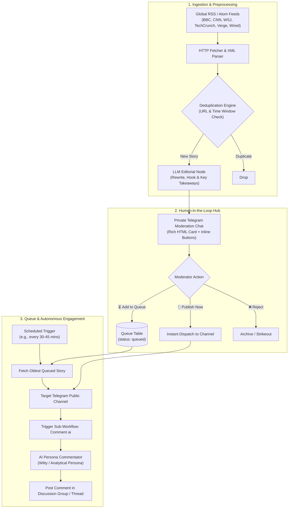

# 📰 Autonomous AI Newsroom & Telegram Media Automation

[](https://n8n.io/)
[](docker-compose.yml)
[](https://core.telegram.org/bots/api)
[%20%2F%20OpenAI-8A2BE2.svg)]()
[](LICENSE)

An end-to-end, autonomous editorial pipeline that aggregates breaking news across global media outlets, filters duplicates, synthesizes punchy summaries via LLM, provides an interactive **Human-in-the-Loop moderation dashboard** in Telegram, manages a timed publication queue, and deploys an **AI Commentator persona** to drive community engagement in the channel.

100% private, self-hosted, and compatible with both local models (LM Studio, Ollama, vLLM) and cloud APIs (OpenAI, Claude, Gemini).

---

## 🏛️ Architecture & Dataflow



---

## ✨ Core Workflows Breakdown

The system is organized into **4 modular, interconnected n8n workflows** located in the [`workflows/`](workflows/) directory:

| Workflow | File | Function |
|---|---|---|
| **01. Ingestion & Curator** | [`01_collector_dedup_and_ai_curator.json`](workflows/01_collector_dedup_and_ai_curator.json) | Scrapes RSS/Atom feeds, eliminates duplicates, formats prompts for LLM, and sends interactive draft cards with buttons to the moderation group. |
| **02. Moderation Callbacks** | [`02_telegram_moderation_callbacks.json`](workflows/02_telegram_moderation_callbacks.json) | Listens for moderator button clicks (`Publish`, `Queue`, `Reject`) via Telegram callbacks, updates database statuses, and routes execution. |
| **03. Scheduled Queue** | [`03_queue_scheduled_publisher.json`](workflows/03_queue_scheduled_publisher.json) | Periodically dequeues pending curated stories, dispatches them to the channel according to your publication calendar, and updates records. |
| **04. AI Commentator** | [`04_ai_comment_generator.json`](workflows/04_ai_comment_generator.json) | Autonomous sub-workflow triggered after a post goes live. Generates an insightful or witty opinionated comment under the post to spark discussions. |

---

## 🚀 1-Click Quick Start

### 1. Clone & Setup Environment
```bash
git clone https://github.com/your-username/ai-newsroom-automation.git
cd ai-newsroom-automation
cp .env.example .env
```

Edit `.env` with your Telegram Bot token and target channel IDs:
```env
TELEGRAM_BOT_TOKEN=1234567890:ABCdefGHIjklMNOpqrSTUvwxYZ
TELEGRAM_MODERATION_CHAT_ID=-100XXXXXXXXXX
TELEGRAM_CHANNEL_ID=@your_channel_name
LLM_API_URL=http://host.docker.internal:1234/v1/chat/completions
```

### 2. Launch n8n in Docker
```bash
docker compose up -d
```
Open **`http://localhost:5678`** in your browser to access the n8n UI.

### 3. Import Workflows
1. Inside n8n, navigate to **Workflows -> Add Workflow -> Import from File**.
2. Import the 4 JSON files from the [`workflows/`](workflows/) folder:
   - `01_collector_dedup_and_ai_curator.json`
   - `02_telegram_moderation_callbacks.json`
   - `03_queue_scheduled_publisher.json`
   - `04_ai_comment_generator.json`
3. Toggle the switches to **Active**.

---

## 🤖 Supported LLM Backends

The workflows communicate with standard OpenAI-compatible `/v1/chat/completions` endpoints:

* **Local / 100% Free**:
  * **LM Studio**: Run your favorite local model (e.g. Llama 3.1 8B, Qwen 2.5 7B) on your GPU. Set `LLM_API_URL=http://host.docker.internal:1234/v1/chat/completions`.
  * **Ollama**: Set `LLM_API_URL=http://host.docker.internal:11434/v1/chat/completions`.
* **Cloud Providers**:
  * **OpenAI / OpenRouter / Groq**: Set `LLM_API_URL` to provider endpoint and specify your API key.

---

## 🛡️ License

MIT License. See [LICENSE](LICENSE) for details.
