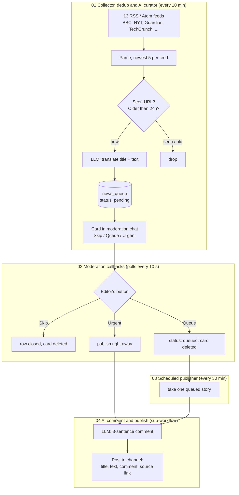

# AI Newsroom: RSS to Telegram with human moderation

[](https://github.com/Pahan4ek/ai-newsroom-automation/actions/workflows/e2e.yml)
[](https://n8n.io/)
[](docker-compose.yml)
[](LICENSE)

A small editorial pipeline for a Telegram news channel, built as four n8n workflows. It pulls RSS feeds every 10 minutes, drops anything already seen, has an LLM translate the fresh stories into Russian, and sends each one to a private moderation chat with three buttons. An editor decides what goes out. Approved stories are published on a schedule, each with a short LLM-written comment attached.

The LLM can be local (LM Studio, Ollama, anything with an OpenAI-compatible `/v1/chat/completions`) or a cloud API.

## How it works



| Workflow | What it does |
|---|---|
| `01_collector_dedup_and_ai_curator.json` | Fetches the feeds, keeps items from the last 24 hours whose URL isn't in `seen_urls`, sends up to 10 of them to the LLM in one request, stores the result in `news_queue` and posts a moderation card for each. |
| `02_telegram_moderation_callbacks.json` | Polls `getUpdates` for button presses. Skip closes the row, Queue marks it `queued`, Urgent calls workflow 04 immediately. The card is deleted from the moderation chat either way. |
| `03_queue_scheduled_publisher.json` | Every 30 minutes takes one `queued` row and hands it to workflow 04. |
| `04_ai_comment_generator.json` | Asks the LLM for a short comment and posts the story to the channel with the comment in italics under the text. |

The prompts are in Russian and the channel output is Russian. Change them in the Code nodes `Для ИИ` (01) and `Промпт для ИИ` (04).

## Setup

You need Docker, a Telegram bot from @BotFather, a private group for moderation and a channel. Add the bot to both: it has to be able to send and delete messages in the group and to post in the channel.

1. Configure:
   ```bash
   git clone https://github.com/Pahan4ek/ai-newsroom-automation.git
   cd ai-newsroom-automation
   cp .env.example .env    # fill in the bot token, chat IDs and LLM settings
   ```
2. Start n8n and open http://localhost:5678. Create the owner account on first launch.
   ```bash
   docker compose up -d
   ```
3. Create two data tables in the **Data tables** tab. The workflows find them by name, so the names must match:
   - `seen_urls` with a string column `url`
   - `news_queue` with string columns `title`, `content`, `url`, `status`
4. Import the workflows from the CLI:
   ```bash
   docker compose exec n8n n8n import:workflow --separate --input=/workflows
   ```
   The CLI keeps the workflow IDs from the files, so 02 and 03 find workflow 04 without manual relinking. If you import through the UI instead, open the `Call 'Comment ai'` node in 02 and 03 and pick workflow 04 again.
5. Publish the workflows in the UI, **04 first**: n8n 2.x refuses to publish a workflow whose sub-workflow isn't published. Then 01, 02 and 03.

### LLM backends

All LLM calls go to `LLM_API_URL` with `Authorization: Bearer $LLM_API_KEY`.

| Backend | `LLM_API_URL` | `LLM_MODEL` |
|---|---|---|
| LM Studio on the host | `http://host.docker.internal:1234/v1/chat/completions` | empty (uses `gemma-4-e4b`) or whatever you loaded |
| Ollama on the host | `http://host.docker.internal:11434/v1/chat/completions` | e.g. `qwen2.5:7b` |
| OpenAI / OpenRouter / Groq | the provider's chat completions URL | a model the provider serves |

## Testing

`tests/e2e/run.sh` runs all four workflows on a real n8n 2.46.6 (SQLite in a temp dir) against a small Python mock of the feeds, the LLM and the Telegram Bot API. It creates the data tables, imports the workflows through the CLI, publishes them and checks the queue after each step: collection and dedup, three different buttons pressed within one poll, the scheduled publish, plus what reached the mock (cards, channel posts, deleted cards, LLM auth header).

```bash
npm i -g n8n@2.46.6   # Node.js 24+
tests/e2e/run.sh
```

GitHub Actions runs it on every push. The script works on its own copy of the workflows: Telegram calls and feeds point at the mock, and 01 and 03 get a test-only webhook so a run can be started without waiting for the schedule.

## Design notes and limits

- **Polling instead of a webhook.** A Telegram trigger needs a public HTTPS URL. Polling `getUpdates` every 10 seconds works on a laptop behind NAT. The bot must not have a webhook set, or `getUpdates` returns nothing.
- **Dedup is by URL only.** The same story from two outlets will reach the moderation chat twice. That's the editor's job for now.
- **URLs are marked as seen before the LLM call.** If the LLM is down, those stories are skipped rather than retried every 10 minutes.
- **LLM output is parsed leniently.** Workflow 01 pulls the first JSON array out of the reply. If parsing fails, the original English text goes to moderation, so nothing is lost silently.
- **Tokens live in env vars**, which is why `N8N_BLOCK_ENV_ACCESS_IN_NODE=false` is set in `docker-compose.yml`. n8n credentials would be the cleaner option for a shared instance.

## License

MIT, see [LICENSE](LICENSE).
